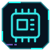
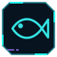

 

 

 &nbsp; 

✉️ reserout [at] gmail [dot] com

## `> whoami`

Hey, I'm **Serhii** — a tech enthusiast based in Québec, Canada. 👋

I'm exploring the intersection of **AI, Linux, industrial automation, and creative technology**. I enjoy hands-on learning: setting things up, testing ideas, breaking them, fixing them, and documenting what works.

I'm building this GitHub space as a public lab for experiments and future projects — **no inflated skill lists, just real progress**.

## `> current_focus`

-  **Local AI & LLMs** — running models on personal devices, studying inference and fine-tuning.
-  **Linux & IT fundamentals** — command line, networking, and system administration.
-  **Industrial automation** — exploring PLC programming and OpenPLC.
-  **Hardware experiments** — learning through small devices and practical projects.
-  **Creative development** — design, web ideas, and digital storytelling.

## `> my_toolbox`

**Learning and experimenting with**

  

These icons represent subjects I'm learning or exploring — not a claim of professional proficiency in every tool.

## `> experiments`

| Area | What I'm working toward |
|:--|:--|
|  **AI Lab** | Local model experiments, evaluation, and practical AI workflows |
|  **IT / Linux Lab** | Small reproducible system administration exercises |
|  **Automation Lab** | PLC logic, simulation, and industrial automation fundamentals |
|  **Hardware Lab** | Useful tools and experiments for compact devices |

## `> projects`

| Project | What it is | Live |
|:--|:--|:--|
|  [qexus.github.io](https://github.com/qexus/qexus.github.io) | Portfolio hub, sitemap, shared i18n/fonts, uptime &amp; browser QA (Playwright, Lighthouse) | [qexus.github.io](https://qexus.github.io/) |
|  [fisheries](https://github.com/qexus/fisheries) | Norway fisheries: public registries, 12-lesson academy, RU/FR/UA, weekly data pipeline in GitHub Actions | [/fisheries/](https://qexus.github.io/fisheries/) |
|  [fisheries-ca](https://github.com/qexus/fisheries-ca) | Canada edition: CFIA / DFO open data, Job Bank snapshots, offline CV &amp; application tracker | [/fisheries-ca/](https://qexus.github.io/fisheries-ca/) |
|  [manac](https://github.com/qexus/manac) | Independent career guide for Manac, Saint-Georges (QC), RU/FR/UA | [/manac/](https://qexus.github.io/manac/) |

All sites are static, privacy-first (no accounts, data stays in the browser) and ship with CSP, automated content/security tests and CI.

---

<code>QEXUS // GLITCH LAB</code> · <i>Curiosity → Experiments → Skills → Projects</i>

