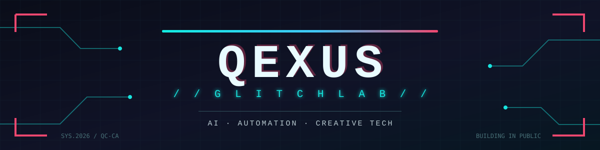

 

## `> whoami`

Hey, I'm **Serhii** — a tech enthusiast based in Québec, Canada. 👋

I'm exploring the intersection of **AI, Linux, industrial automation, and creative technology**. I enjoy hands-on learning: setting things up, testing ideas, breaking them, fixing them, and documenting what works.

I'm building this GitHub space as a public lab for experiments and future projects — **no inflated skill lists, just real progress**.

## `> current_focus`

- 🤖 **Local AI & LLMs** — running models on personal devices, studying inference and fine-tuning.
- 🐧 **Linux & IT fundamentals** — command line, networking, and system administration.
- ⚙️ **Industrial automation** — exploring PLC programming and OpenPLC.
- 🛠️ **Hardware experiments** — learning through small devices and practical projects.
- 🎨 **Creative development** — design, web ideas, and digital storytelling.

## `> my_toolbox`

**Learning and experimenting with**

  

These icons represent subjects I'm learning or exploring — not a claim of professional proficiency in every tool.

## `> experiments`

| Area | What I'm working toward |
|:--|:--|
| 🧠 **AI Lab** | Local model experiments, evaluation, and practical AI workflows |
| 🖥️ **IT / Linux Lab** | Small reproducible system administration exercises |
| 🏭 **Automation Lab** | PLC logic, simulation, and industrial automation fundamentals |
| 🎛️ **Hardware Lab** | Useful tools and experiments for compact devices |

> As I publish projects, I'll replace this roadmap with links to real repositories and demos.

## `> github_activity`

<!-- Once you publish at least one code repository, remove the comment markers
     around the following block to display your most-used repository languages.

  

-->

---

<code>QEXUS // GLITCH LAB</code> · <i>Curiosity → Experiments → Skills → Projects</i>

